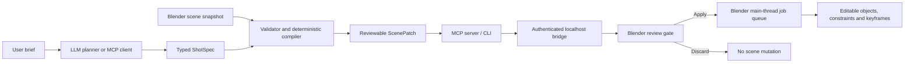

# Architecture

FaceLink separates language understanding from Blender mutation. This is the core product
decision: an LLM is useful for intent and rough staging, but should not own object identity,
threading, undo state or arbitrary code execution.

## Trust boundary

The Blender extension accepts only five operation names: `keyframe_transform`, `look_at`,
`play_clip`, `ensure_camera` and `set_frame_range`. It never accepts Python source or a
generic Blender operator name. The bridge binds to `127.0.0.1`, uses a random bearer token,
limits request bodies to 4 MiB, and routes every `bpy` mutation through a Blender timer on
the main thread.

Successful patches retain up to 50 in-memory FaceLink rollback snapshots. MCP and the Blender
panel use this stack instead of relying on `bpy.ops.ed.undo()`, whose UI-context polling is not
reliable for background or remote bridge jobs. A separate 100-entry audit log is stored on
the Blender Scene and survives `.blend` save/load. Persisted audit entries are never presented
as executable snapshots after a restart.

Protocol 1.12 adds a second, external task journal for crash diagnosis. It is bounded to 256
allowlisted lifecycle records, is written by atomic replacement, and deliberately excludes job
payloads, results, raw errors, scene snapshots, file paths and credentials. Saved files are
associated through a one-way workspace hash; unsaved scenes are process-scoped. Startup turns
unfinished records into a user-visible recovery report but never requeues or replays them.
The durable `transaction_committed` checkpoint lets the user distinguish “rescan and plan
again” from “inspect revision history before retrying” without treating the journal as an
executable rollback snapshot.

## Blender 任务与恢复中心的数据流

v0.5.0 的第一个界面切片在现有运行时和任务日志之上增加一层只读产品状态模型。Blender
面板不会直接展示运行时字典，也不会在 `draw()` 中调用会推进任务的快照接口：

1. `JobRuntime.task_center_view()` 在运行时锁内复制允许列表字段，但不处理排队超时、
   不改变运行时版本，也不持久化任务日志；
2. `bridge.product_status()` 在生命周期锁内组合任务视图、内存中的恢复状态、本机实例编号
   和协议版本；
3. `build_product_status()` 再次验证标识、枚举和数量边界，只向面板返回最多 6 个活动任务
   和 3 个最近结果；
4. Blender 定时器在桥接活动/恢复状态下每 0.5 秒、离线空闲时每 2 秒读取这份只读模型，
   只有模型变化才标记 3D 视图重绘，不访问磁盘、网络或模型提供商。

产品状态明确排除 payload、result、Scene Snapshot、Scene Patch、场景名称和路径、端口、
原始异常及凭据。取消任务和确认恢复不复用这条只读路径，而是经过显式 Operator、运行时
控制锁和任务日志持久化。无效任务编号在查找以前失败，避免把任意输入反射回界面或日志。

排队任务取消是即时状态转换。运行任务采用协作式安全检查点；由于 `bpy` 修改在 Blender
主线程同步执行，长操作占用主线程期间，面板按钮本身可能无法获得执行机会，独立 HTTP/
MCP 客户端才能并行提交取消请求。取消与完成竞争时保留真实最终状态，并单独标记
“取消请求后完成”，不使用异步异常强杀 Blender。

取消先更新本次会话的内存状态，再尝试写任务日志。若写入失败，排队任务仍从当前队列移除，
运行任务仍保留协作式取消请求；HTTP/UI 按两种状态分别报告 `journal_unavailable`，运行
任务的最终结果明确保持未知，不使用“已经停止”或“不会执行”的错误承诺。

恢复确认只原子更新日志中的确认状态，不重排、重放、应用、撤销或回滚任务。如果写入
失败，内存恢复状态不提前清除。恢复要求存在时，HTTP 在创建任务前拒绝
`apply_staged_patch`、`apply_patch`、`undo` 和 `rollback_revision`，返回 HTTP 409 /
`recovery_review_required`；Blender Operator 也禁用对应入口。扫描、读取、暂存和丢弃等
不会应用动画或几何变更的操作仍可用于检查；扫描可能为对象补齐 FaceLink 稳定 ID
元数据。加载其他 `.blend` 以前会停止桥接；加载后清除临时
暂存和会话回滚快照。首次保存或另存为改变工作区编号时也会停止桥接，用户需为当前文件
手工重启。未知未来日志版本仍在启动阶段失败关闭并保留原文件。

桥接协议、任务日志和界面状态各自独立版本化：当前桥接协议是 1.13（兼容 1.12），任务
日志 schema 是 1.0，任务中心状态 schema 也是独立的 1.0。不能根据相同数字假设它们
可以互换或互相降级。

这一层不负责 Codex/ChatGPT 订阅登录或 API Key 存储，也不读取 `auth.json`。它只是
Blender 内的桥接、任务和恢复界面。“本机桥接已就绪”不代表 AI 或任何认证方式已经
连接；完整用户行为见
[Blender 任务与恢复中心](TASK_CENTER.md)。

协议 1.13 在这个本地边界上增加显式版本协商和关联诊断。每个 HTTP 请求有独立
`request_id`；客户端工作流提供的随机关联种子经本次桥接 Token 做 HMAC 后，才作为
`correlation_id` 写入任务生命周期和诊断事件，因此不会把调用方原始种子当成可回显
内容。经过认证的 `/v1/diagnostics` 只读取有界、严格允许列表中的版本、能力、计数、
状态、稳定错误码和随机标识，不读取请求正文或场景内容。`facelink diagnostics` 再次
脱敏并只在本地原子写出 JSON，不提供自动上传路径。

这些措施是可观测性与隐私控制，不是本地进程沙箱。同一操作系统账户下能读取发现
记录的恶意进程，或 Blender 进程内的任意 Add-on，仍处在当前隔离保证之外。桥接连接
线程也尚无全局并发上限；有界请求体和任务队列不能完全阻止本地拒绝服务。完整边界和
残余风险见[威胁模型](THREAT_MODEL.md)。

Rollback history is linear: selecting an older revision restores every newer FaceLink
revision first, followed by the selected revision. Manual edits made after a FaceLink patch
can still be overwritten by its snapshot restore and remain an explicit alpha limitation.

The default v0.2 path has a second safety boundary: the bridge preflights and stages one
patch, Blender displays its operation count, affected objects, frame span and warnings, and
only an explicit apply action mutates the scene. This review gate is provider-independent,
so an MCP client can use its existing model subscription while BYOK users use the CLI.
The explicit `apply_scene_patch` MCP tool remains a power-user bypass, so possession of MCP
and bridge authority must itself be treated as permission to mutate the current scene.

BYOK planning crosses a separate network trust boundary: FaceLink sends the user's brief,
serialized Scene Snapshot and any supplied retarget profiles to the configured OpenAI-compatible
endpoint. They may contain scene-facing names and transforms. The provider key is not written
to `.blend`, the task journal or the privacy-safe diagnostic export, but the remote provider,
proxy and custom `base_url` remain responsible for data handling after transmission. An MCP
client using its own subscription can likewise transmit tool input/output according to that
client's policy; FaceLink cannot impose data-residency guarantees on it.

The v0.2.3 preflight rejects overlapping operations on the same transform/action channel and
FaceLink NLA-strip collisions. Existing editable keyframes are reported as review warnings
instead of hard failures, because overwriting them can be intentional. Staging also builds a
transient GPU overlay from the patch: cyan world-space movement paths and orange predicted
camera frustums. Overlay geometry is kept outside Blender datablocks and is cleared with the
staged patch, so previewing does not dirty or mutate the scene.

Protocol 1.3 adds a deterministic navigation layer before patch generation. Explicitly marked
Blender meshes are triangulated into a compact world-space graph. The core package finds
connected polygon routes with A*, converts shared-edge portals into waypoints, allocates frames
by traveled distance and emits the same whitelisted `keyframe_transform` operation used by
direct motion. Obstacles use a conservative swept-AABB test with actor bounds and clearance.
The complete marked environment has its own fingerprint, preventing new obstacles or mesh
edits from bypassing the earlier entity-scoped scene guard.

Protocol 1.4 adds a non-mutating camera-composition preflight inside Blender. It reuses the
same predicted camera transform as the viewport frustum, projects all eight world-space target
bounds corners into normalized frame coordinates and reports subject size, center offset,
safe-area fit and clipping. A scene ray cast from the predicted camera to the target bounds
center adds an explainable first-occluder warning. Dolly shots are sampled at both endpoints.
The analyzer runs during stage and apply preflight, creates no cameras or render data and puts
the same warnings into the review summary and execution receipt. Target transforms are
evaluated at the camera operation's declared start/end frames, then the user's current timeline
frame and subframe are restored; camera execution uses the same frame contract.

Protocol 1.5 adds bounded rig and Action inventories to Scene Snapshot 1.3. The extension
exports armature bone names, parents and rest-space head/tail coordinates, plus Action frame
ranges, pose-bone channels, data paths and a curve-content fingerprint. The deterministic
compiler checks that a `play_clip` Action exists and that its channels resolve onto the target
rig before it emits a patch. Scene Patch 1.3 carries one source-Action fingerprint per clip;
Blender verifies it at stage and apply so edited or deleted source motion fails closed.

The first adapter is `rename_only`. It copies the source Action, rewrites pose-bone FCurve
paths and group names through an explicit JSON map, and assigns the copy to an ordinary NLA
strip. Its deterministic name makes repeat application idempotent. Rollback restores the NLA
state and removes a FaceLink-created Action when it has no remaining users. This adapter makes
no claim about different rest poses, axes, proportions, control rigs or root-motion policy;
the later `bake_pose` adapter handles a bounded subset with stronger geometric validation.

Protocol 1.6 adds Scene Snapshot 1.4 rest-orientation quaternions and deterministic Rig
fingerprints. A pure-Python analyzer compares each reviewed mapping in parent-local space,
checks mapped hierarchy, separates uniform rig scale from per-bone proportion drift and emits
per-bone angular/length metrics. Deterministic name suggestions are limited to exact,
punctuation/case-normalized and a small documented alias table; suggestions are never applied
and always require review. The compiler blocks `rename_only` for `bake_required` or
`incompatible` geometry. Scene Patch 1.4 guards every referenced armature, so an Edit Mode
rest-pose change between scan, stage and apply fails before mutation.
Uniform rig scale is separated from per-bone proportion drift, but an Action with pose-bone
location channels is rejected when source and target scale differ because `rename_only` cannot
rescale those translations without baking.

Protocol 1.7 adds the bounded `bake_pose` adapter. The extension evaluates an explicit source
Action on a temporary armature copy on Blender's main thread and samples each mapped
`PoseBone.matrix_basis` over the Action's native range. Because this basis is relative to the
bone's parent and own rest transform, writing it through the target bone's own basis corrects
different local rest axes without an LLM attempting 3D matrix reasoning. Root translation uses
an explicit scale/preserve/drop policy; non-root translation is scaled by mapped bone length.
The generated Action contains ordinary linear location/rotation/scale FCurves and follows the
same staging, fingerprint, idempotency, NLA and rollback contract as `rename_only`.
Rig fingerprints include pose rotation modes in protocol 1.7, so switching a target between
Euler, quaternion and axis-angle after staging cannot silently produce or reuse wrong channels.

Protocol 1.8 adds `bake_evaluated_pose` for the common controller-to-deform case. It assigns the
source Action to the original source rig with NLA muted, lets Blender evaluate its existing
self-contained constraints/drivers, reads final `PoseBone.matrix` values, and uses Blender's
inverse local/pose conversion before writing ordinary target keys. Rig fingerprints now include
constraint settings, driver definitions and control custom properties. The operation restores
source Action/slot, NLA state, object transform, control-property values, pose and timeline even
when baking fails.

Protocol 1.9 adds optional Armature object-motion output to both bake adapters. The sampler
computes `inverse(source_first_world) @ source_current_world`, optionally scales its translation
by the mapped-rig median length ratio, and composes the result after the captured target world
matrix. This produces editable object FCurves without copying absolute source coordinates or
discarding target placement. v1 rejects parents, object constraints, singular transforms and
driven target object channels rather than hiding a space-conversion ambiguity.

This is intentionally a deform-skeleton adapter, not a universal control-rig solver. Runtime
preflight rejects missing mapped parents, changed hierarchy, zero-length bones, constraints on
mapped source/target bones, pose transform drivers, multi-slot Actions, non-transform pose
channels, Edit Mode, old unguarded patch schemas and workloads above fixed sample/curve/key
limits. Object-level channels are omitted unless `object_motion` is explicit. Those restrictions keep failure visible while
leaving automatic IK/FK discovery, external dependency graphs and hierarchy mediation for later
adapters. Existing self-contained constraint/driver graphs can use `bake_evaluated_pose`.

Protocol 1.1 adds optimistic scene consistency. The compiler fingerprints scene timing and
the world-space state of only the objects referenced by a patch. Blender checks that value
both when staging and when applying, so an intervening transform, parent, lock or timing edit
cannot be silently overwritten. Unrelated scene edits do not invalidate the patch.

## Why three layers

1. **Core Python package** owns schemas, validation and deterministic compilation. It is
   testable without Blender or an API key.
2. **Blender extension** owns scene identity and mutation. It has no pip dependencies, so it
   installs cleanly through Blender's extension mechanism.
3. **MCP/CLI sidecar** owns model-provider integrations and process communication. API
   dependencies and credentials never need to be embedded in a `.blend` file.

## Compatibility contract

扩展清单声明 Blender 4.2 为最低版本，验收矩阵覆盖 4.2 LTS、4.5 LTS 和选定的最新稳定
5.x。代码避免依赖 Blender 私有 API，但“测试了一个 5.x”不等于未来所有 5.x 都自动
受支持。

当前桥接写出协议 1.13，并且只明确支持 1.12、1.13。经过认证的 `/v1/health` 是版本
无关启动入口，客户端从双方 `supported_versions` 的交集中选择最高版本；非健康请求
必须携带选定版本，缺少版本头仅按旧协议 1.12 解释。无交集在任务读取和排队前失败，
不能根据相同主版本猜测兼容。

产品、桥接协议、ShotSpec、Scene Snapshot、Scene Patch、任务日志、修订审计和诊断导出
各自独立版本化。特别是未知未来任务日志会让旧桥接失败关闭并保留原文件，不会自动
降级、隔离、覆盖或重放。完整版本表、升级/降级步骤和破坏性变更规则见
[兼容性与迁移政策](COMPATIBILITY.md)。

## Known MVP constraints

- Object and camera locations are planned in world space and converted to editable local
  channels. Rotation or scale under sheared/non-uniform parent chains still needs a future
  full-matrix solver; armature pose bones are not yet part of this object transform path.
- `play_clip` requires an existing Blender Action. `rename_only` handles compatible armatures;
  `bake_pose` handles direct deform Actions; `bake_evaluated_pose` additionally samples an
  existing self-contained source control graph. Both require equivalent mapped hierarchy.
  Automatic mapping approval, control-rig/IK-FK discovery, external dependencies, parented or
  constrained object roots and general motion generation remain out of scope.
- Navigation planning is currently a single-level XY projection over explicitly marked static
  geometry. It does not yet solve stacked floors, moving obstacles, crowds or character gait.
- Camera composition preflight is geometric and evaluates the current target bounds plus the
  initial camera state (and both dolly endpoints). It does not judge lighting, aesthetics,
  partial-surface occlusion or future animated deformations. v0.3.3 supports perspective
  cameras without lens shift and explicitly declines unsupported projections; broader camera
  models and artistic judgment need a later render/vision evaluator.
