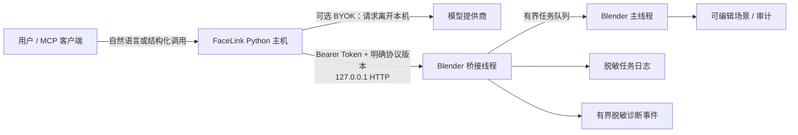

# FaceLink 威胁模型

本文描述当前 FaceLink Alpha 版实际保护什么、信任什么，以及仍需由用户或后续版本
解决的风险。它不是安全认证，也不把“仅监听本机”表述成对所有本地程序都安全。

## 需要保护的资产

- 打开的 `.blend`、场景结构、对象/骨骼/Action 名称、位置和动画数据；
- Blender 中尚未保存的编辑、当前时间线、Action/NLA 和 FaceLink 回滚状态；
- Blender 桥接 Bearer Token 与包含该 Token 的实例发现记录；
- `OPENAI_API_KEY` 等模型提供商凭据，以及发给模型提供商的提示和场景快照；
- MCP/Codex 配置、本地 FaceLink 状态目录、任务日志和 `.blend` 内的审计元数据；
- 安装包、扩展 ZIP、Wheel、校验和及更新来源。

## 信任边界



语言模型不直接获得任意 Python 或 Blender Operator 执行能力。正常路径先生成严格的
ShotSpec，再由确定性编译器生成操作白名单中的 Scene Patch。HTTP 线程不调用 `bpy`，
而是把任务放入有界队列，由 Blender 主线程执行；变更路径使用预检、暂存、人工复核和
事务回滚。

## 威胁、现有缓解与残余风险

| 威胁 | 当前缓解 | 仍然存在的风险 |
|---|---|---|
| 远程网络直接调用桥接 | 只绑定 `127.0.0.1`，每次启动生成随机 Bearer Token，所有端点（包括健康检查）都要求认证 | 回环监听没有 TLS；若系统代理、端口转发或主机本身被攻破，回环边界不再成立 |
| 未授权网页或本地程序提交任务 | Token 不写入 `.blend`；实例记录原子替换，POSIX 尝试使用目录 `0700`/文件 `0600`，读取时最多选择 32 个候选且每个不超过 16 KiB，响应不开放 CORS；请求体限制 4 MiB，任务队列和保留记录有界 | **同一操作系统账户下的恶意进程**通常能读取该账户的临时文件或进程环境，因而可能取得 Token，也能用名称靠前的伪记录排挤合法候选；Windows 当前依赖用户目录/临时目录继承的 ACL，不是独立沙箱，也没有额外进程身份握手 |
| 任意 Blender Add-on 绕过 FaceLink | FaceLink 自身只允许固定操作，HTTP 变更转到主线程并经过校验 | **任意已安装 Blender Add-on 与 FaceLink 同处一个 Python/bpy 进程**，可直接读写场景、模块内状态或文件；此攻击者不在 FaceLink 隔离保证内 |
| 恶意或错误的 LLM 输出修改场景 | 严格结构、操作白名单、实体/场景/Action/Rig 指纹、工作量上限、预检、暂存复核和事务回滚 | `apply_scene_patch` 是明确保留的高级直接应用入口；拥有 MCP/桥接权限的调用者可绕过 Blender 面板复核。用户仍须控制谁能调用 MCP 工具 |
| 队列、内存或线程耗尽 | 请求体最大 4 MiB；待处理任务 128、保留任务 256、诊断事件 256、导出实例/任务/事件都有上限 | `ThreadingHTTPServer` 的连接/处理线程目前没有全局并发上限；同账户恶意客户端仍可用大量或慢连接造成进程内拒绝服务 |
| 密钥、场景或异常文本写入任务日志 | 日志使用字段白名单，只保留随机标识、任务类型/状态/时间/检查点等；不保存 payload、结果、场景快照、路径、Token、提供商密钥或原始异常 | 文件系统被同账户进程读取时，仍会暴露任务类型、时间和关联关系；突然断电下的刷盘语义受操作系统和文件系统保证限制 |
| 未知未来日志被旧版破坏 | 未来 `schema_version` 失败关闭，保留原文件，不隔离为损坏文件、不覆盖、不自动重放 | 用户手工删除、改版本号或状态目录仍可破坏恢复证据；需要备份和匹配版本处理 |
| 状态目录中的工作区编号被误认为匿名信息 | 已保存文件只把规范化路径的 SHA-256 截断值写入状态文件名，不直接写出原路径 | 这是可关联的**伪名**而不是匿名或加密：已知候选路径可被字典猜测；当前跨平台统一 `casefold`，在区分大小写的平台还存在路径碰撞风险 |
| 两个 Blender 进程同时打开同一已保存文件 | 单进程内使用锁、同目录临时文件和原子替换，正常重启可读取上一会话 | 当前工作区日志按 `.blend` 路径命名，没有跨进程文件锁或会话 CAS；两个进程同时为同一文件启动桥接会产生最后写入者覆盖和错误恢复判断。修复前不要在两个进程中同时为同一已保存文件启动 FaceLink 桥接 |
| 诊断包泄露隐私 | `facelink diagnostics` 使用严格允许列表、第二次敏感模式扫描、1 MiB 上限和原子写入；只含版本、能力、计数、状态、稳定错误码及随机关联标识 | 脱敏不能证明所有组合信息都无业务敏感性；操作系统类型、版本、时间和任务模式仍可用于环境指纹。分享前仍应人工查看 |
| 关联请求时把调用方标识当成秘密外带 | 每个响应产生随机 `request_id`；合法客户端关联种子会用本次桥接 Token 做 HMAC 后再记录/返回，不回显原种子 | 关联编号用于排错而非访问控制；同一关联编号会揭示哪些请求属于同一工作流，Token 重启后派生值也会变化 |
| BYOK 请求把内容发往外部 | API Key 从参数或进程环境读取，不写入 `.blend`、任务日志或安全诊断包；调用需由用户显式配置 | BYOK 规划会把**用户 brief、序列化场景快照和可选重定向配置**发送到所配置的 OpenAI 兼容端点，可能包含场景/对象/骨骼/Action 名称和变换。数据处理受该提供商、代理和 `base_url` 控制 |
| MCP 客户端自身的数据外发 | FaceLink 可让 MCP 客户端使用其已有模型，不要求 FaceLink 保存 API Key | MCP 客户端可能按自身政策把工具输入/输出发给云端模型；FaceLink 无法替该客户端提供数据驻留承诺。ChatGPT 订阅也不是 OpenAI API Key |
| `.blend` 审计元数据随文件外发 | 执行快照不持久化；任务日志与安全诊断不记录名称 | `.blend` 内审计会持久化标题、对象/Action 名称、警告和时间等元数据。共享 `.blend` 前应检查或主动清理历史 |
| 安装包或更新被替换 | 发布提供 `SHA256SUMS.txt`，安装流程校验内嵌载荷；文档要求从官方 Release 获取 | 当前 Windows EXE **未代码签名**。同一被攻破的发布渠道可同时替换产物和校验和；SmartScreen 的未知发布者警告是仍未消除的供应链风险 |

## 安全诊断的明确隐私边界

`facelink doctor` 是本机环境检查，面向用户本人，可能显示 Blender 可执行文件、发现
目录、MCP 启动器等本机路径，因此不应把 Doctor 原始输出直接当成可公开附件。

用于分享的是单独的命令：

```powershell
facelink diagnostics --out facelink-diagnostics.json
```

该命令只在本地生成一个 JSON，不向外部服务提交（只访问本机回环桥接），也不打开
上传页面。它不会读取 `auth.json`，也不会把原始日志、任务日志、发现记录、`.blend`
或 MCP 配置复制进诊断包。为了发现并认证正在运行的本机桥接，它会在内存中读取实例
发现记录，但其中的 Token、场景名和文件路径不会进入导出。导出允许包含：

- FaceLink、Python、Blender 和桥接协议版本；
- 能力名、检查结果、队列/恢复计数和稳定错误码；
- 随机请求、任务、关联和诊断编号，以及有限时间戳；
- 是否配置 API Key 的布尔值（不含 Key 本身）。

导出明确排除绝对路径、用户名/邮箱、主机名、场景/对象/骨骼/Action 名称、brief、
prompt、Scene Snapshot、Scene Patch、请求 payload、结果、原始异常、Bearer Token、API
Key 和私钥。最多收集 32 个实例、每实例 64 个最近任务和 256 个事件，总文件不超过
1 MiB；默认不覆盖已有文件。命令返回的 `uploaded: false` 是行为声明，不是上传开关。
用户应在手工附到 Issue 或私密安全报告前再次打开检查。

## 明确不在当前保证内的攻击者

- 已能以同一操作系统账户运行任意代码的恶意进程；
- 任意 Blender Add-on、启动脚本或被植入的 `.blend` Python 代码；
- 管理员、内核、调试器、恶意安全软件或已被攻破的操作系统；
- 被攻破的 MCP 客户端、模型提供商、兼容代理或用户自行配置的 `base_url`；
- 用户主动批准的直接应用、手工删除状态文件或绕过校验的安装操作。

这些边界不表示相关风险不重要，而是说明 FaceLink 当前没有进程隔离、系统凭据库、
代码签名或远端策略执行能力。若工作内容敏感，应使用单独操作系统账户、最小化已安装
Add-on、限制 MCP 客户端权限、审查提供商数据政策，并在受控环境验证发布校验和。

## 漏洞报告

不要在公开 Issue 中粘贴真实 Token、API Key、`.blend` 或未检查的 Doctor 输出。请按
[安全政策](../SECURITY.md)使用 GitHub 私密漏洞报告，并在分享前使用安全诊断导出。
版本和迁移规则见[兼容性与迁移政策](COMPATIBILITY.md)。
